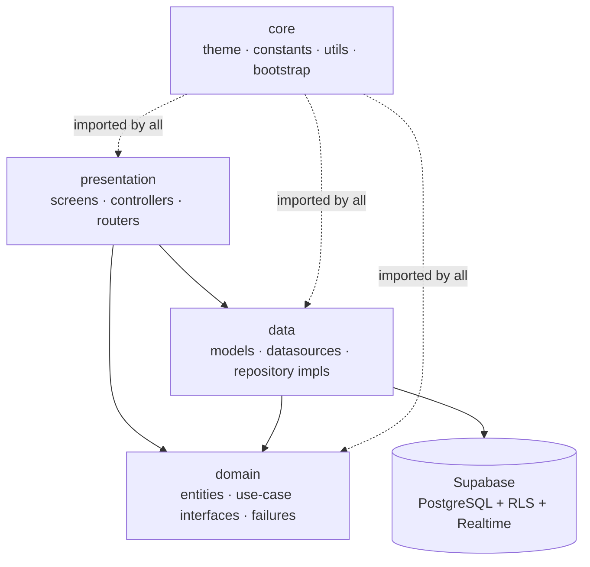

# Gym Pro — نظام إدارة صالات رياضية

Gym management system built with **Flutter** and **Supabase**, split into four
role-based applications served from three entry points: **Admin**,
**Reception**, and a mobile app for **Trainer + Trainee**. Arabic-first UI with
full RTL support.

| | |
|---|---|
| **Platforms** | Android · iOS · Web · Windows · macOS (see [platform status](#platform-status)) |
| **Language** | Dart `3.5.4` · Flutter `3.24.5` |
| **UI** | Arabic, full RTL, dark theme, responsive phone → desktop |
| **Backend** | Supabase (PostgreSQL + Row Level Security + Realtime). Schema and server-side logic are managed in the Supabase project. |
| **Size** | 222 Dart source files in `lib/` · 17 test files |

[](../../actions/workflows/ci.yml)

---

## Contents

1. [What it does](#1-what-it-does)
2. [Highlights](#2-highlights)
3. [Architecture](#3-architecture)
4. [Entry points and role guard](#4-entry-points-and-role-guard)
5. [Tech stack (resolved versions)](#5-tech-stack-resolved-versions)
6. [Getting started](#6-getting-started)
7. [Commands](#7-commands)
8. [Notifications](#8-notifications)
9. [Testing](#9-testing)
10. [Platform status](#10-platform-status)
11. [Known limitations](#11-known-limitations)
12. [Built with AI assistance](#12-built-with-ai-assistance)
13. [Author and license](#13-author-and-license)

---

## 1. What it does

### Admin (web-first — `lib/main_admin.dart`)
Dashboard with live stats and charts, user management (staff/trainees,
created through Supabase Edge Functions), halls and access periods, group
session templates, a weekly schedule view, and financial reports with PDF
export.

### Reception (web-first — `lib/main_reception.dart`)
Member check-in (name/phone search or QR scan), membership create/renew with
overlap validation, group and private-session booking with capacity checks,
trainer assignment, manual payment recording, and a daily schedule.

### Trainer (mobile — `lib/main_mobile.dart`)
Trainee list with detail view, training-program builder (days → exercises),
diet builder (days → meals), attendance history, fixed private-schedule view.

### Trainee (mobile — `lib/main_mobile.dart`)
Personal QR code for check-in, group-session booking, membership status,
my-trainer page, program and diet viewers, booking/membership history,
private-session bookings.

---

## 2. Highlights

All verified against the code in this repository:

1. **Three clean layers** — `domain/` is pure Dart (zero Flutter/Supabase
   imports, enforced by review); only `data/datasources/` touch Supabase
   query builders.
2. **Repository interfaces in the domain** — 12 `i_*_repository.dart`
   interfaces; DI wiring in `lib/data/providers.dart`.
3. **Realtime notifications** — Supabase Realtime stream per user with a live
   unread badge (`notifications` table, RLS-scoped).
4. **Role-based entry gating** — `RoleGuard` + per-entry router redirects;
   wrong-role sessions are signed out.
5. **Arabic PDF export** — Cairo font embedded in `pdf` documents with RTL
   text direction.
6. **QR check-in** — static per-trainee QR plus scanner with duplicate
   same-day check-in prevention in the client.
7. **Date-safe memberships** — date-only columns, overlap checks on create
   and renew, RPC-assisted expiry sweep.
8. **Widget + unit test suite** — 166 test cases across 17 files, including
   server-contract parsing and deep-link mapping for notifications.

---

## 3. Architecture

Clean Architecture with strictly unidirectional dependencies:



Rules confirmed in this codebase:

- `lib/domain` contains **no** `package:flutter`, `package:supabase`, or
  Riverpod imports — plain Dart + `equatable` + `dartz`.
- Supabase query builders (`.from`, `.rpc`, `.stream`) appear **only** in
  `lib/data/datasources` (plus one role lookup in `lib/core/auth`).
- Errors are typed `Failure` classes; repositories return
  `Either<Failure, T>`.
- Screens observe state through Riverpod providers declared per feature.

> Honest note: several presentation screens currently call datasources or
> import models directly (program/diet/private-session builders), and many
> controllers unwrap `Either` by throwing. This is tracked in
> `docs/internal/` as known tech debt.

---

## 4. Entry points and role guard

There is **no `main.dart`** — every run/build needs an explicit `--target`:

| File | Allowed roles | Target |
|---|---|---|
| `lib/main_admin.dart` | `admin` | Wide screens / web |
| `lib/main_reception.dart` | `reception` | Wide screens / web |
| `lib/main_mobile.dart` | `trainer`, `trainee` | Phones / tablets |

Role is read from the `profiles` table (60-second client cache) and enforced
by `RoleGuard` at login and by each router's `redirect`. Demo accounts:
`TODO(author)` — document the accounts you create in your Supabase project.

---

## 5. Tech stack (resolved versions)

From `pubspec.lock`:

| Concern | Package (resolved) |
|---|---|
| State management | `flutter_riverpod` 2.6.1 |
| Backend | `supabase_flutter` 2.15.4 |
| Navigation | `go_router` 14.8.1 |
| PDF | `pdf` 3.11.3 · `printing` 5.14.3 |
| QR | `qr_flutter` 4.1.0 · `mobile_scanner` 5.2.3 |
| Local notifications | `flutter_local_notifications` 19.5.0 · `timezone` 0.10.1 |
| Charts | `fl_chart` 0.69.2 |
| Styling | `google_fonts` 6.3.0 (Cairo) · `flutter_svg` 2.1.0 |
| Functional helpers | `dartz` 0.10.1 · `equatable` 2.1.0 |
| Env loading | `flutter_dotenv` 5.2.1 |
| Testing | `flutter_test` · `mocktail` 1.0.5 |
| Linting | `flutter_lints` 4.0 · `custom_lint` + `riverpod_lint` |

Declared but currently unused in code: `flutter_screenutil`, `http`.

---

## 6. Getting started

**Prerequisites:** Flutter 3.24.x (Dart 3.5.4), a Supabase project.

1. Copy the env file and fill in your project's public values
   (**anon/publishable key only — never a `service_role` key**):

   ```bash
   cp .env.example .env
   ```

   ```env
   SUPABASE_URL=https://YOUR-PROJECT.supabase.co
   SUPABASE_ANON_KEY=YOUR_ANON_OR_PUBLISHABLE_KEY
   ```

2. Install and (optionally) run code generation:

   ```bash
   flutter pub get
   dart run build_runner build --delete-conflicting-outputs   # currently: 0 outputs (models are hand-written)
   ```

3. Run an entry point:

   ```bash
   flutter run -t lib/main_admin.dart     -d chrome
   flutter run -t lib/main_reception.dart -d chrome
   flutter run -t lib/main_mobile.dart    -d <device-id>
   ```

The database schema and server-side logic (triggers, cron, Edge Functions
`create-user` / `delete-user`) live in the Supabase project and are not part
of this repository.

---

## 7. Commands

```bash
flutter analyze --no-pub
dart run custom_lint
flutter test
flutter build apk   --debug   --target=lib/main_mobile.dart
flutter build web   --release --target=lib/main_admin.dart
flutter build web   --release --target=lib/main_reception.dart
```

---

## 8. Notifications

Two layers, no paid push infrastructure:

### Layer 1 — in-app (Supabase Realtime)

The `notifications` table is streamed per user (`user_id` filter + RLS).
`NotificationBell` shows a live unread badge (99+ cap) in the admin shell,
reception shell, trainer dashboard, and trainee dashboard.
`NotificationsScreen` supports mark-read, mark-all, swipe-delete, pull-to-refresh,
and **deep-links** each item to the recipient role's screen via the
`data.screen` payload (`my_bookings`, `membership`, `my_trainer`, `trainees`,
`fixed_schedule`).

Notifications are created **only on the server** (triggers + a daily cron for
`membership_expiring_soon`). The client maps all six server types and never
crashes on unknown types.

### Layer 2 — local scheduled notifications

`flutter_local_notifications` is initialized (with Android channel,
`POST_NOTIFICATIONS` runtime permission, inexact scheduling, boot receivers,
core-library desugaring) and wrapped in `try/catch` for unsupported platforms.
No client-side scheduling events are wired up yet, and the timezone database
is initialized without a device-zone lookup (`tz.local` defaults to UTC;
scheduled instants would still fire correctly via `TZDateTime.from`, but a
device-timezone package is recommended before enabling scheduling).

### Honest limitation

**There is no push service (no FCM/OneSignal). A user whose app is not
running receives nothing for server-side events. In-app notifications arrive
only while the app is open; local reminders (when wired up) fire only if they
were scheduled earlier on the same device.**

---

## 9. Testing

```bash
flutter test
```

Current state (measured on this repository):

| Metric | Value |
|---|---|
| Test files | 17 |
| Test cases | 166 |
| Passing | 147 |
| Failing (pre-existing) | 19 — stale widget tests: `private_sessions_screen_test` (15), `daily_schedule_screen_test` (3), `drawer_hit_test` (1) |
| Hanging | `drawer_nav_test.dart` contains a test that times out (excluded from CI) |

Notification coverage is the strongest area: server-contract type parsing,
`data` jsonb payloads, deep-link mapping for all six `screen` values × roles,
unread-count live updates, stream-error resilience, and logout cleanup.

---

## 10. Platform status

| Platform | Status | Evidence |
|---|---|---|
| Android (debug APK, mobile target) | **Verified build** | `flutter build apk --debug --target=lib/main_mobile.dart` succeeds; merged manifest contains `POST_NOTIFICATIONS`, boot receivers, desugaring |
| Web (release, admin target) | **Verified build** | `flutter build web --release --target=lib/main_admin.dart` succeeds |
| Web (reception/mobile targets) | Scaffolded only | same toolchain, not built in this review |
| iOS | Scaffolded only | `ios/` present; no Apple toolchain verification |
| macOS / Windows | Scaffolded only | folders present; no verification |
| Release APK signing | Unverified | no keystore configured |

---

## 11. Known limitations

- **No push notifications** — see the honest limitation above.
- Presentation layer bypasses use cases in several features (direct
  datasource calls in program/diet/private-session screens).
- Some list queries have no pagination/limits (payments, attendance history).
- PDF export embeds the Cairo font but does not enable Arabic shaping
  (`pdf` package flag), so connected-letter rendering in PDFs is imperfect.
- QR payload is a static `trainee_<uuid>` (no signature/expiry).
- 19 pre-existing failing widget tests and one hanging test (see Testing).
- Edge Functions `create-user` / `delete-user` live only in the Supabase
  project (documentation gap).

See `docs/internal/VERIFICATION_REPORT.en.md` for the full finding list.

---

## 12. Built with AI assistance

This project was built with AI assistance (Claude) under the author's
direction. The author decided the architecture (Clean Architecture, three
entry points, Riverpod, Supabase), the feature set per role, the Arabic RTL
design, and the notification design; the AI generated large portions of the
implementation, tests, and documentation drafts, and the author reviewed,
integrated, and refined the result. Personal claims (demo data, deployment
history, client feedback) are marked `TODO(author)`.

---

## 13. Author and license

**Jawad Azzam** — [LinkedIn](https://www.linkedin.com/in/jawad-azzam-dev/)

Released under the [MIT License](LICENSE).
