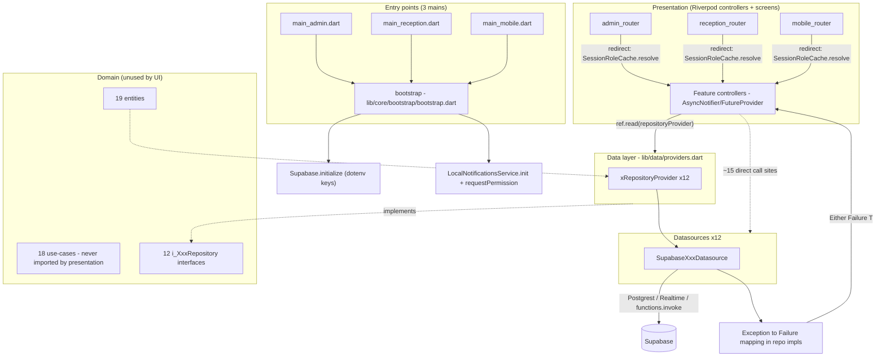
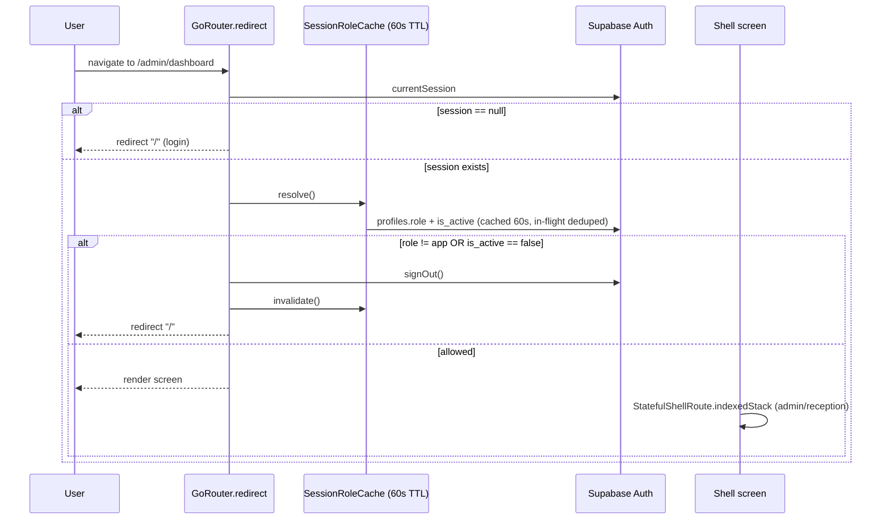
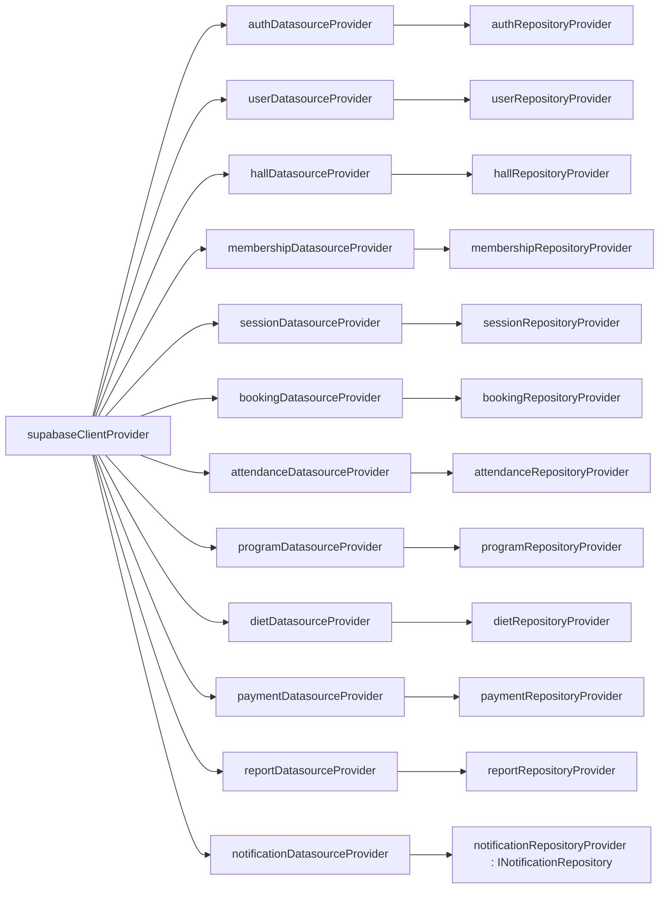
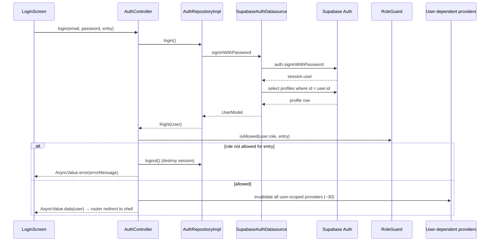
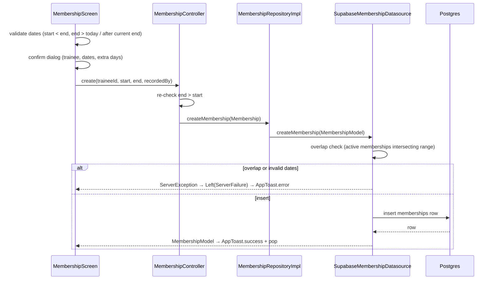
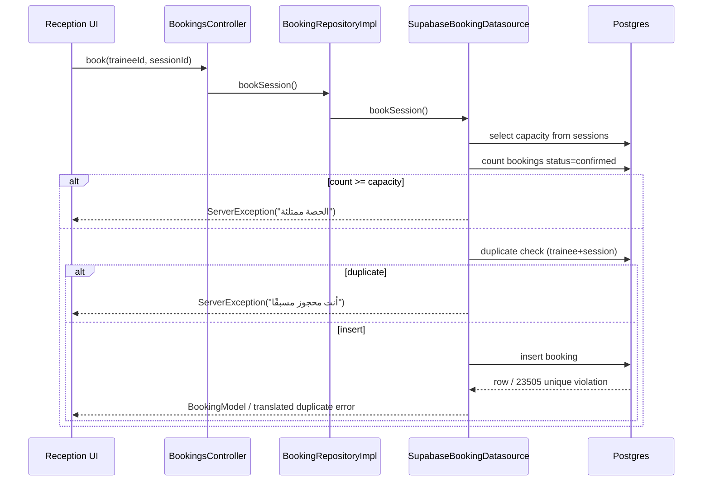
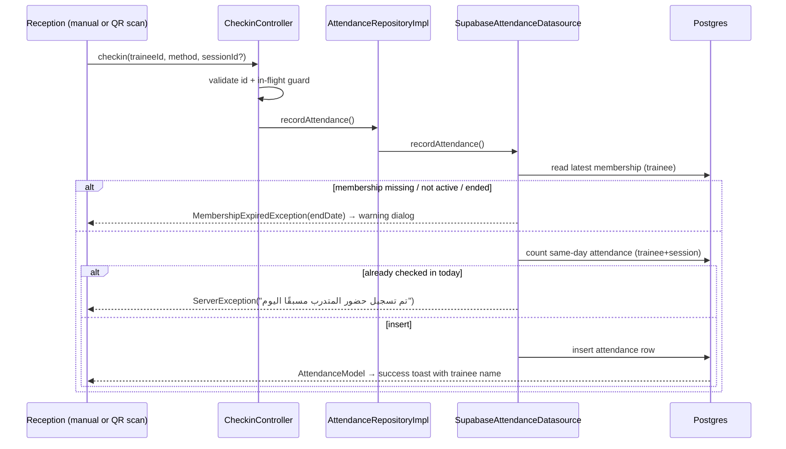
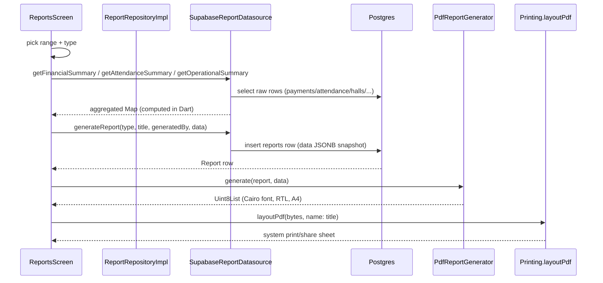
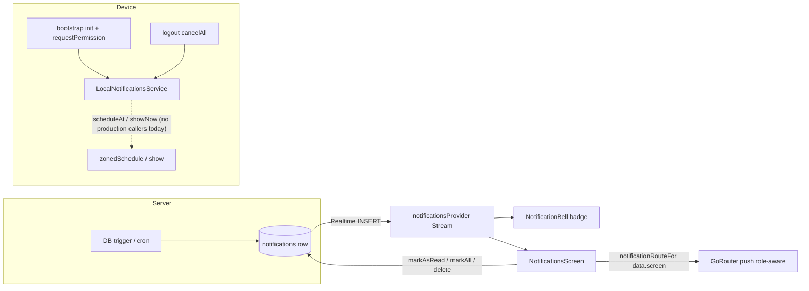

# PROJECT_GUIDE.md — Gym Pro (Flutter + Supabase)

> Exhaustive, code-verified engineering guide for the `gym_pro` Flutter application.
> Every claim below is traceable to a file in this repository (paths cited inline).
> Where a value could not be verified from source, it is marked **unverified** rather than guessed.
> Branch: `docs/final-review` · Document written: 2026-10-20.

---

## 1. Purpose & Glossary

### 1.1 What this app is

`gym_pro` is a single Flutter codebase that ships **three separate application entry points** (three `main()`s) for a gym-management system backed by Supabase:

| Entry point | File | Intended device | Audience |
|---|---|---|---|
| Admin portal | `lib/main_admin.dart` | Desktop / large screen | Owner / manager (`admin`) |
| Reception portal | `lib/main_reception.dart` | Desktop / large screen | Front-desk staff (`reception`) |
| Mobile app | `lib/main_mobile.dart` | Phone / tablet | Trainers and trainees (`trainer`, `trainee`) |

Each entry point boots the same shared domain/data layers and selects a different `GoRouter`:

- `lib/main_admin.dart` → `adminRouter` (`lib/presentation/admin/router/admin_router.dart`)
- `lib/main_reception.dart` → `receptionRouter` (`lib/presentation/reception/router/reception_router.dart`)
- `lib/main_mobile.dart` → `mobileRouter` (`lib/presentation/mobile/router/mobile_router.dart`)

All three share the same Supabase project, the same Postgres schema, and the same notification tables.

### 1.2 Glossary (English ↔ Arabic ↔ DB)

| English term | Arabic UI label | DB table / column |
|---|---|---|
| Profile (auth user) | مستخدم / ملف | `profiles` (id = `auth.users.id` UUID, `name`, `email`, `phone`, `role`, `gender`, `is_active`, `created_at`) |
| Role | دور | `profiles.role` + JWT claim `app_role` |
| Trainee | متدرب | `profiles.role = 'trainee'` |
| Trainer | مدرب | `profiles.role = 'trainer'` |
| Membership | عضوية / اشتراك | `memberships` (`trainee_id`, `status`, `start_date`, `end_date`, `recorded_by`) |
| Group session | حصة (جماعية) | `sessions` (`capacity`, `start_date`, `end_date`, `status`, `trainer_id`, `hall_id`, `name`) |
| Hall | قاعة | `halls` (`name`, `capacity`, `is_active`, `open_time`, `close_time`, `default_slot_minutes`) |
| Access period | فترة وصول | `access_periods` (`hall_id`, `day_of_week` 0=Sat..6=Fri, `start_time`, `end_time`, `access_type`, `trainer_id`, `title_or_reason`, `is_active`) |
| Session–period link | ربط الحصة بالفترة | `session_periods` (`session_id`, `access_period_id`) |
| Booking | حجز | `bookings` (`trainee_id`, `session_id`, `status='confirmed'`) |
| Attendance | حضور | `attendance` (`trainee_id`, `check_in_time`, `method='qr'|'manual'`, `session_id?`) |
| Trainer–trainee relation | تعيين المدرب | `trainer_trainees` (`trainer_id`, `trainee_id`, `status`, `assigned_by`, `assigned_at`) |
| Private session | جلسة خاصة | `private_training_sessions` (`trainer_trainee_id`, `session_date`, `status`, `recorded_by`, `slot_id?`) |
| Fixed weekly slot | موعد ثابت | `private_training_schedule` (`trainer_trainee_id`, `day_of_week`, `start_time`, `end_time`, `is_active`, `created_by`) |
| Training program | برنامج تدريب | `training_programs` + `program_days` + `program_exercises` |
| Diet plan | نظام غذائي | `diets` + `diet_days` + `diet_meals` |
| Payment | دفعة | `payment_costs` (`type='income'|'expense'`, `category`, `amount`, `payment_date`, `description`, `user_id`, `recorded_by`) |
| Report | تقرير | `reports` (`type`, `title`, `data` JSONB, `generated_by`) |
| In-app notification | إشعار | `notifications` (`user_id`, `title`, `body`, `type`, `entity_id`, `is_read`, `data` JSONB) |

### 1.3 Hard numbers verified from source

- **223** Dart files under `lib/` (104 presentation, 49 domain, 44 data, 23 core, 3 `main_*.dart` at `lib/` root).
- **17** test files under `test/`.
- **19** entities in `lib/domain/entities/`, **18** use-cases in `lib/domain/usecases/`, **12** repository interfaces in `lib/domain/repositories/`.
- **12** datasources, **12** repository implementations, **19** models in `lib/data/`.
- **29** `path:` entries in the mobile router, **12** in the admin router, **12** in the reception router.
- Test suite (Flutter 3.24.5): `166` tests executed → `147` pass, `19` fail (breakdown in §12).
- Git history: 3 commits (`6b9b1ad` initial, `843872b` chore, `10731a9` notifications fix) plus uncommitted work.

> A note on the common "222 files / 34 routes" figures floating in older docs: the repository actually has **223** files and the mobile router declares **29** paths, not 34. This guide uses the verified counts.

---

## 2. Tech Stack & Packages

Runtime: **Flutter 3.24.5** (Dart SDK `^3.5.4` per `pubspec.yaml:7`).

### 2.1 Direct dependencies (`pubspec.yaml` → resolved in `pubspec.lock`)

| Package | Constraint | Resolved | Role in app |
|---|---|---|---|
| `flutter_riverpod` | `^2.5.0` | 2.6.1 | State management (manual providers, no codegen in `lib/`) |
| `riverpod_annotation` | `^2.3.0` | 2.6.1 | Declared but unused for codegen in `lib/` |
| `supabase_flutter` | `^2.5.0` | 2.15.4 | Backend: Auth, Postgrest, Realtime, Edge Functions |
| `go_router` | `^14.0.0` | 14.8.1 | Declarative routing, 3 router instances |
| `freezed_annotation` / `freezed` | `^2.4.0` / `^2.5.0` | 2.4.4 / 2.5.7 | Declared; domain entities are hand-written classes, not freezed |
| `json_annotation` / `json_serializable` | `^4.9.0` / `^6.8.0` | 4.9.0 / 6.9.0 | JSON models (`fromJson` handwritten in practice) |
| `flutter_screenutil` | `^5.9.0` | 5.9.3 | **Unused** — no import anywhere in `lib/` |
| `google_fonts` | `^6.2.0` | 6.3.0 | Cairo font in `lib/core/theme/app_theme.dart` |
| `flutter_svg` | `^2.0.0` | 2.1.0 | SVG rendering (shared widgets) |
| `cached_network_image` | `^3.3.0` | 3.4.1 | Cached images |
| `qr_flutter` | `^4.1.0` | 4.1.0 | Trainee QR generation (`lib/presentation/trainee/qr_code/`) |
| `mobile_scanner` | `^5.0.0` | 5.2.3 | Reception QR check-in scanner (`lib/presentation/reception/checkin/screens/qr_scan_screen.dart`) |
| `fl_chart` | `^0.69.0` | 0.69.2 | Finance/attendance charts (admin reports) |
| `pdf` | `^3.11.0` | 3.11.3 | PDF generation |
| `printing` | `^5.12.0` | 5.14.3 | PDF preview/share (`lib/core/utils/pdf_report_generator.dart`) |
| `intl` | `^0.19.0` | 0.19.0 | Date/number formatting (`lib/core/utils/formatters.dart`) |
| `equatable` | `^2.0.0` | 2.1.0 | Value equality for failures/entities |
| `dartz` | `^0.10.0` | 0.10.1 | `Either<Failure, T>` functional error handling |
| `flutter_dotenv` | `^5.1.0` | 5.2.1 | Loads `.env` (Supabase URL + anon key) |
| `http` | `^1.2.0` | 1.6.0 | Declared for Edge-Function diagnostics; not used in `lib/` runtime paths found |
| `flutter_local_notifications` | `19.5.0` (pinned) | 19.5.0 | Local reminders layer (see §10) |
| `timezone` | `^0.10.0` | 0.10.1 | Required by local notifications |
| `cupertino_icons` | `^1.0.8` | 1.0.8 | Icons |
| `app_links` (override) | `6.3.2` | 6.3.2 | Deep links (transitive; pinned via `dependency_overrides`) |

### 2.2 Dev dependencies

`flutter_test`, `flutter_lints ^4.0.0`, `build_runner ^2.4.0`, `custom_lint ^0.6.0`, `riverpod_lint ^2.3.0`, `mocktail ^1.0.5` (all resolved versions in `pubspec.lock`).

### 2.3 Assets (`pubspec.yaml:66-73`)

`.env`, `assets/images/`, `assets/icons/`, `assets/illustrations/`, `assets/fonts/` (includes `Cairo.ttf`, loaded by `PdfReportGenerator._loadFont`, `lib/core/utils/pdf_report_generator.dart:13`).

---

## 3. Architecture

### 3.1 Layering

The project follows a Clean-Architecture-inspired split, but **presentation mostly bypasses the domain use-case layer** and calls repositories (and sometimes datasources) directly:

```
lib/
├── main_admin.dart | main_reception.dart | main_mobile.dart   (3 entry points)
├── core/            # constants, theme, utils, auth helpers, notifications service, bootstrap
├── domain/          # entities (19), repository interfaces (12), use-cases (18)
├── data/            # models (19), Supabase datasources (12), repository impls (12), providers.dart
└── presentation/    # admin/ reception/ mobile/ trainee/ trainer/ shared/
```

Key observation #1 — **use-cases are essentially dead code from the UI's perspective**: the 18 classes in `lib/domain/usecases/**` are never imported by any screen or controller. Screens call `ref.read(xRepositoryProvider)` (or, in ~15 places, a datasource provider directly). The use-case classes exist as an unused seam (a representative example: `CreateMembershipUc` at `lib/domain/usecases/membership/create_membership_uc.dart` is a one-line delegate to `repository.createMembership`).

Key observation #2 — **manual Riverpod, no codegen**: `lib/data/providers.dart` declares every datasource and repository as a plain `Provider`; presentation controllers are `AsyncNotifier`/`StateNotifier`/`FutureProvider` written by hand. `riverpod_annotation`/`build_runner` are installed but `lib/` contains no generated `*.g.dart`/`*.freezed.dart` files (verified by file listing).

### 3.2 Architecture diagram (layers + request flow)



### 3.3 Navigation & auth-guard diagram

All three routers share the same guard pattern: `redirect` reads the Supabase session, resolves the user's role through `SessionRoleCache` (60-second TTL + in-flight dedupe, `lib/core/auth/session_role.dart`), signs out and bounces to `/` when the role doesn't match the app, and otherwise lets navigation proceed (`lib/presentation/*/router/*_router.dart`).

`SessionRoleCache` details worth knowing for interviews:

- `resolve()` fetches `role, is_active` from `profiles` for the current `auth.users.id`, caches both for **60 seconds** (`ttl = Duration(seconds: 60)`, `session_role.dart:14`).
- An `_inFlight` future deduplicates concurrent `redirect()` calls (GoRouter can invoke `redirect` multiple times per navigation; the code comments document a real incident of "4 requests for the same uid in 4 seconds" before the fix, `session_role.dart:19-24`).
- On network failure it **returns the last known values instead of nulls**, so a flaky network never causes a false logout (`session_role.dart:64-68`).
- `invalidate()` clears everything (called on logout and on failed auth).

The router is also rebuilt on auth-state changes via `AuthRefreshListenable` (`lib/core/auth/auth_refresh.dart`), a `ChangeNotifier` that subscribes to `onAuthStateChange` and is passed as `refreshListenable` to each `GoRouter`.



Mobile additionally enforces prefix rules: `/trainer/**` requires role `trainer`, `/trainee/**` requires `trainee` (`lib/presentation/mobile/router/mobile_router.dart:160-165`).

Role-vs-entry is also enforced **at login time** in `lib/presentation/shared/auth/controllers/auth_controller.dart:89-98`: if the authenticated role isn't allowed for the chosen entry (`AppEntry.admin|reception|mobile`, `lib/core/auth/role_guard.dart`), the session is destroyed immediately and an error is surfaced. The allowed-role table is:

| Entry | Allowed roles |
|---|---|
| `AppEntry.admin` | `admin` only |
| `AppEntry.reception` | `reception` only |
| `AppEntry.mobile` | `trainer`, `trainee` |

---

## 4. Conventions & How to Add a Feature

### 4.1 Naming & structure conventions (observed)

- File naming: `snake_case.dart`; widgets/screens suffixed `_screen.dart`, controllers `_controller.dart`, datasources `supabase_*_datasource.dart`, repo impls `*_repository_impl.dart`, models `*_model.dart`, entities singular without suffix (`booking.dart`, `membership.dart`).
- Feature folders per role: `lib/presentation/{admin,reception,trainer,trainee}/<feature>/{screens,controllers}`.
- Shared code: `lib/presentation/shared/{widgets,auth,notifications,settings,schedule}`.
- State: controllers live next to features; cross-feature lists are invalidated centrally on login/logout (`AuthController._invalidateAllUserDependentProviders`, `auth_controller.dart:33-77`).
- Errors: datasources throw typed exceptions (`lib/core/errors/exceptions.dart`: `ServerException`, `AuthException`, `ValidationException`, `NetworkException`, `CacheException`, `MembershipExpiredException`, `ScheduleConflictException`); repository impls `catch` and convert to `Failure` subclasses (`lib/core/errors/failures.dart`) wrapped in `dartz.Either`.
- UI strings are **inline Arabic literals** in widgets (not centralized; `lib/core/constants/app_strings.dart` exists but has **0 references** from `lib/`).
- Colors: only `lib/core/constants/app_colors.dart` tokens (plus ~25 raw `Color(0x…)` literals remaining in presentation — see §15).
- Dates: server timestamps ISO-8601 strings; `day_of_week` convention **0 = Saturday … 6 = Friday** (`lib/core/utils/day_of_week_helper.dart`); legacy 1–7 values are normalized at display time (`day_of_week_helper.dart:18-19`).
- Models **extend** their entity (e.g., `class MembershipModel extends Membership`, `lib/data/models/membership_model.dart:4`) and add `fromJson`/`toJson`/`toInsertJson`/`toEntity` — this avoids the entity→model copy boilerplate at the price of a tight coupling.

### 4.2 Recipe: adding a new CRUD feature (e.g., "Coupons")

1. **Model + entity** — add `lib/data/models/coupon_model.dart` (`fromJson`/`toInsertJson`) and `lib/domain/entities/coupon.dart` (Equatable, props list).
2. **Datasource** — `lib/data/datasources/supabase_coupon_datasource.dart`, taking `SupabaseClient` in the constructor, wrapping failures in `ServerException`.
3. **Repository interface** — `lib/domain/repositories/i_coupon_repository.dart` returning `Either<Failure, …>`.
4. **Repository impl** — `lib/data/repositories_impl/coupon_repository_impl.dart` (try datasource → `Right`, `on ServerException` → `Left(ServerFailure)`; see `membership_repository_impl.dart` as the canonical pattern).
5. **Providers** — register `couponDatasourceProvider` + `couponRepositoryProvider` in `lib/data/providers.dart` (see §8 for the graph).
6. **Controller** — `lib/presentation/<role>/coupons/controllers/coupons_controller.dart` (`AsyncNotifier` or `FutureProvider`), reading only the repository provider (pattern: `membership_controller.dart`).
7. **Screen** — `.../screens/coupons_screen.dart` using `AppCard`, `AppButton`, `AppToast`, `LoadingIndicator`, `AsyncErrorView` (§5.6).
8. **Route** — add a `GoRoute` to the relevant router (admin/reception/mobile), inside the `StatefulShellRoute.indexedStack` branches for shell navigation; add a shell destination in the corresponding `*_shell_screen.dart`.
9. **Auth invalidation** — if the data is user-specific, add `ref.invalidate(couponsProvider)` to `AuthController._invalidateAllUserDependentProviders`.
10. **Tests** — model round-trip test under `test/models/`, repository test with `mocktail` under `test/repositories/`, screen test under `test/screens/` (see §12 for the working pattern).

### 4.3 Recipe: adding a local reminder

`LocalNotificationsService` (`lib/core/notifications/local_notifications_service.dart`) is a singleton (`instance`), with `init()`, `requestPermission()`, `showNow()`, `scheduleAt()`, `cancel(id)`, `cancelAll()`, plus pure helpers `toTz()`, `isSchedulable()`, `idFor(key)` that are unit-testable without platform channels. Bootstrap already calls `init()` + `requestPermission()` (`lib/core/bootstrap/bootstrap.dart:43-44`), and logout calls `cancelAll()` (`auth_controller.dart:134`). To schedule, call `scheduleAt` — note that **no production call site does so today** (see §10 and §15). Every method swallows platform failures and returns `false` instead of crashing (design goal stated in the class doc comment).

---

## 5. Design System

### 5.1 Brand

"Athletic Pulse — Dark Modernism" tokens, all in `lib/core/constants/app_colors.dart`:

- Primary: `#FF5722` (Athletic Orange), hover `#E64A19`, glow `#59FF5722` (35% opacity).
- Dark surface ladder L0→L3: `background #101319` → `surface #1A1D23` → `surfaceLow #1E222A` → `surfaceCard #232730` → `surfaceOverlay #2B303C`.
- Text tiers: `textPrimary #FFFFFF`, `textSecondary #D1D5DB`, `textMuted #9CA3AF`, `textOnSurface #E1E2EA`.
- Semantic: `success #10B981`, `warning #F59E0B`, `error #EF4444`, `info #3B82F6`, `errorContainer #93000A`.
- Legacy aliases kept for compatibility: `primaryDark #B02F00`, `secondary #C3C6D2`, `disabled #6B7280`.

### 5.2 Contrast ratios (WCAG, computed against tokens)

| Foreground | Background | Ratio | WCAG AA (normal text) |
|---|---|---|---|
| textPrimary | background | 18.60 | ✅ AAA |
| textSecondary | background | 12.62 | ✅ AAA |
| textMuted | background | 7.32 | ✅ AAA |
| textOnSurface | background | 14.41 | ✅ AAA |
| textPrimary | surface | 16.88 | ✅ AAA |
| textSecondary | surface | 11.46 | ✅ AAA |
| textMuted | surface | 6.65 | ✅ AA |
| textMuted | surfaceLow | 6.28 | ✅ AA |
| textPrimary | surfaceCard | 14.95 | ✅ AAA |
| textSecondary | surfaceCard | 10.15 | ✅ AAA |
| textMuted | surfaceCard | 5.89 | ✅ AA |
| textOnSurface | surfaceCard | 11.58 | ✅ AAA |
| textPrimary | surfaceOverlay | 13.20 | ✅ AAA |
| white | primary (button) | 3.16 | ⚠️ fails AA for normal text; OK for large/bold |
| white | primaryHover | 3.92 | ⚠️ borderline |
| primary | background | 5.88 | ✅ AA |
| primary | surfaceCard | 4.73 | ✅ AA |
| success | background | 7.33 | ✅ AAA |
| warning | background | 8.66 | ✅ AAA |
| error | background | 4.94 | ✅ AA |
| info | background | 5.06 | ✅ AA |
| error | surfaceCard | 3.97 | ⚠️ borderline (badge/large text) |
| error | surface | 4.49 | ✅ AA (borderline) |
| disabled | background | 3.85 | ⚠️ intentionally low (disabled) |

**Takeaway for interviews:** body text on dark surfaces comfortably exceeds AAA; the weakest pairs are white-on-primary buttons (3.16) and error-on-surfaceCard (3.97) — both fine for large/bold UI text but below AA for small text.

### 5.3 Typography & dimensions

- Font: Cairo via `google_fonts` in `lib/core/theme/app_theme.dart` (dark `ThemeData`).
- Spacing/geometry constants: `lib/core/constants/app_dimensions.dart`.
- Breakpoints: `lib/core/utils/responsive_layout.dart` — `600` (mobile/desktop) and `1100` (desktop-wide) logical pixels.

### 5.4 RTL

All three entry points force RTL (`MaterialApp` `locale: ar` + `Directionality.rtl`) — verified in `lib/main_admin.dart`, `lib/main_reception.dart`, `lib/main_mobile.dart`. The UI is Arabic-first; English appears only in enum names, DB values, and debug logs. The PDF generator mirrors this with `pw.TextDirection.rtl` and the embedded Cairo font (`pdf_report_generator.dart:25-26`).

### 5.5 Status & badges

`StatusBadge` shared widget renders colored chips for membership/booking/session statuses; `NotificationBell` (`lib/presentation/shared/widgets/notification_bell.dart`) shows a `Badge` with `99+` cap, fed by `unreadNotificationsCountProvider` (derived from the Realtime stream — zero extra network calls, and it degrades to `0` on stream errors so the bell never crashes, `notifications_controller.dart:19-25`).

### 5.6 Shared widget catalog (`lib/presentation/shared/widgets/`)

| Widget | Importers (files) | Purpose |
|---|---|---|
| `AppCard` | 39 | Standard elevated container |
| `AppToast` | 15 | Success/error snackbar helper |
| `AppButton` | 13 | Buttons with `primary`/`secondary` variants, loading state, optional arrow |
| `AppTextField` | 7 | Labeled text field with icons |
| `LoadingIndicator`, `AsyncErrorView`, `EmptyState`, `UserSearchField`, `StatusBadge`, `StatCard` | used across screens | Async UX + display helpers |
| `NotificationBell` | shells + screens | Unread badge + push to notifications route |
| `AdaptiveNavScaffold` | `admin_shell_screen.dart`, `reception_shell_screen.dart` | Responsive nav rail/drawer |
| **Unused (0 importers)** | — | `AppDatePicker`, `AppDropdown`, `AppTable`, `AthleticScaffold`, `ResponsiveLayout`, `SectionHeader`, `ReceptionSlideDrawer` |

`ReceptionSlideDrawer` (`lib/presentation/reception/widgets/reception_slide_drawer.dart`) is additionally **wrong**: it navigates to `/reception/memberships/new` and `/reception/memberships/renew`, which are not declared in any router.

---

## 6. Roles, Entry Points & Routes

### 6.1 Role matrix

| Role | Entry app | Router | Shell | Login entry param |
|---|---|---|---|---|
| `admin` | `main_admin.dart` | `admin_router.dart` | `AdminShellScreen` (indexed stack, 6 branches) | `AppEntry.admin` |
| `reception` | `main_reception.dart` | `reception_router.dart` | `ReceptionShellScreen` (9 branches) | `AppEntry.reception` |
| `trainer` | `main_mobile.dart` | `mobile_router.dart` | `MobileShellScreen` (5 tabs: dashboard, trainees, my schedule, general schedule, settings) | `AppEntry.mobile` |
| `trainee` | `main_mobile.dart` | `mobile_router.dart` | `MobileShellScreen` (5 tabs: dashboard, schedule, my bookings, fixed sessions, settings) | `AppEntry.mobile` |

`RoleGuard.isAllowed` (`lib/core/auth/role_guard.dart`) is the single source of truth for "role × entry" compatibility; `AuthController.login` enforces it and signs out mismatches. The mobile shell swaps tab sets (and resets the selected index) whenever the authenticated role changes (`mobile_router.dart:99-102`).

### 6.2 Admin routes (12)

| Path | Screen | Guard |
|---|---|---|
| `/` | `LoginScreen(entry: admin)` | — |
| `/admin/notifications` | `NotificationsScreen` | admin |
| `/admin/dashboard` | `AdminDashboardScreen` | admin (shell branch) |
| `/admin/users` | `UsersListScreen` | admin (shell branch) |
| `/admin/users/new` | `UserFormScreen` | admin |
| `/admin/users/:id` | `UserFormScreen(userId, user?)` | admin |
| `/admin/halls` | `HallsListScreen` | admin (shell branch) |
| `/admin/halls/:id/periods` | `AccessPeriodsScreen` | admin |
| `/admin/sessions` | `SessionsListScreen` | admin (shell branch) |
| `/admin/sessions/new` | `SessionFormScreen` | admin |
| `/admin/finance/reports` | `ReportsScreen` | admin (shell branch) |
| `/admin/schedule` | `DailyScheduleScreen` | admin (shell branch) |

### 6.3 Reception routes (12)

`/` (login), `/reception/notifications`, `/reception/dashboard`, `/reception/checkin`, `/reception/checkin/qr`, `/reception/memberships`, `/reception/bookings/group`, `/reception/bookings/private`, `/reception/trainer-assignment`, `/reception/payments/record`, `/reception/schedule`, `/reception/trainees/new` (with `lockedRole: UserRole.trainee` — reception can create trainees only).

### 6.4 Mobile routes (29)

Login `/`, shell `/mobile`, `/mobile/settings`, `/mobile/notifications`; trainer: `/trainer/dashboard`, `/trainer/trainees`, `/trainer/trainees/:id`, `/trainer/programs/new`, `/trainer/programs/:id/days`, `/trainer/programs/days/:dayId/exercises`, `/trainer/programs/:programId/days/:dayId/exercises`, `/trainer/diets/new`, `/trainer/diets/:id/days`, `/trainer/diets/days/:dayId/meals`, `/trainer/diets/:dietId/days/:dayId/meals`, `/trainer/attendance`, `/trainer/schedule`, `/trainer/all-schedule`; trainee: `/trainee/dashboard`, `/trainee/qr`, `/trainee/bookings`, `/trainee/bookings/group`, `/trainee/membership`, `/trainee/schedule`, `/trainee/program`, `/trainee/diet`, `/trainee/trainer`, `/trainee/attendance`, `/trainee/private-sessions`.

The mobile router also passes rich `extra` payloads: `/trainer/programs/new` accepts a `TrainingProgram` or a `Map{program, initialTraineeId}` (`mobile_router.dart:192-206`); `/trainer/diets/new` mirrors it for `Diet` (`:217-230`).

### 6.5 Dead routes (declared, never navigated to)

Verified by searching every `context.push/go` string in `lib/` and `test/`: **`/mobile/settings`**, **`/trainee/qr`**, **`/trainee/dashboard`**, **`/trainee/schedule`**, **`/trainer/dashboard`**, **`/trainer/all-schedule`**, **`/trainer/programs/days/:dayId/exercises`**, **`/trainer/diets/days/:dayId/meals`** have no navigation call sites (the shell's `IndexedStack` shows these screens directly instead of routing). `/trainer/programs/:programId/days/:dayId/exercises` and `/trainer/diets/:dietId/days/:dayId/meals` are the live variants.

---

## 7. Domain Layer (entities & use-cases)

### 7.1 Entities (19, `lib/domain/entities/`) — field-level reference

All entities are `Equatable` with explicit `props`. Fields (verified from source):

| Entity | File | Fields |
|---|---|---|
| `User` | `user.dart` | `id` (String UUID), `name`, `phone`, `email`, `role: UserRole`, `gender: Gender`, `isActive`, `createdAt` |
| `Membership` | `membership.dart` | `id` (int), `traineeId`, `startDate`, `endDate`, `status: MembershipStatus`, `recordedBy?`, `createdAt`; computed `isActive`, `isExpired` |
| `Session` | `session.dart` | `id`, `name`, `description?`, `hallId`, `trainerId?`, `accessPeriodId?`, `startDate`, `endDate`, `capacity`, `status: SessionStatus`, `createdBy?`, `createdAt` |
| `Hall` | `hall.dart` | `id`, `name`, `capacity`, `isActive`, `openTime='08:00:00'`, `closeTime='22:00:00'`, `defaultSlotMinutes=60` |
| `AccessPeriod` | `access_period.dart` | `id`, `hallId`, `dayOfWeek`, `startTime`, `endTime`, `accessType: AccessType`, `trainerId?`, `titleOrReason?`, `isActive` |
| `Booking` | `booking.dart` | `id`, `traineeId`, `sessionId`, `status: BookingStatus`, `createdAt` |
| `Attendance` | `attendance.dart` | `id`, `traineeId`, `checkInTime`, `method: AttendanceMethod`, `sessionId?` |
| `TrainerTrainee` | `trainer_trainee.dart` | `id`, `trainerId`, `traineeId`, `status: TrainerTraineeStatus`, `assignedAt`, `assignedBy?`, `trainerName?`, `traineeName?` (names come from Postgrest joins) |
| `PrivateTrainingSession` | `private_training_session.dart` | `id`, `slotId?`, `trainerTraineeId`, `sessionDate`, `status: PrivateSessionStatus`, `recordedBy?`, `createdAt`, `trainerName?`, `traineeName?` |
| `PrivateTrainingSchedule` | `private_training_schedule.dart` | `id`, `trainerTraineeId`, `dayOfWeek`, `startTime`, `endTime`, `isActive`, `createdBy`, `createdAt`, `trainerName?`, `traineeName?` |
| `TrainingProgram` | `training_program.dart` | `id`, `trainerId`, `traineeId`, `name`, `description?`, `startDate`, `endDate?`, `isActive`, `createdAt` (+ `copyWith`) |
| `ProgramDay` | `program_day.dart` | `id`, `programId`, `dayOfWeek`, `muscleGroup?`, `orderIndex` |
| `ProgramExercise` | `program_exercise.dart` | `id`, `dayId`, `exerciseName`, `sets?`, `reps?`, `notes?`, `orderIndex` |
| `Diet` | `diet.dart` | `id`, `trainerId`, `traineeId`, `name`, `description?`, `startDate`, `endDate?`, `isActive`, `createdAt` (+ `copyWith`) |
| `DietDay` | `diet_day.dart` | `id`, `dietId`, `dayOfWeek`, `orderIndex` |
| `DietMeal` | `diet_meal.dart` | `id`, `dayId`, `mealType`, `description`, `calories?`, `orderIndex` |
| `PaymentCost` | `payment_cost.dart` | `id`, `userId?`, `type: PaymentType`, `category: PaymentCategory`, `amount`, `paymentDate`, `description?`, `recordedBy?`, `createdAt` |
| `Report` | `report.dart` | `id`, `type`, `title`, `description?`, `generatedBy?`, `createdAt`, `data?` (JSONB snapshot) |
| `AppNotification` | `notification_item.dart` | `id`, `userId`, `title`, `body?`, `type: NotificationType`, `entityId?`, `isRead`, `createdAt`, `data?` (JSONB); helpers `dataString(key)`, `copyWith(isRead)` |

`AppNotification.data` is the JSONB payload used for deep-linking: `notificationRouteFor` reads `data['screen']` and maps it to a role-specific route (§10.1).

### 7.2 Use-cases (18, `lib/domain/usecases/`)

| Group | Classes |
|---|---|
| `auth/` | `LoginUc`, `LogoutUc`, `GetCurrentUserUc` |
| `membership/` | `CreateMembershipUc`, `RenewMembershipUc`, `CheckMembershipStatusUc` |
| `session/` | `CreateSessionUc`, `BookSessionUc`, `CancelBookingUc` |
| `attendance/` | `RecordAttendanceUc`, `GetAttendanceHistoryUc` |
| `program/` | `CreateTrainingProgramUc`, `GetTraineeProgramsUc` |
| `diet/` | `CreateDietPlanUc`, `GetTraineeDietsUc` |
| `payment/` | `RecordPaymentUc`, `GetPaymentsUc` |
| `report/` | `GenerateReportUc` |

Each is a thin constructor-injected delegate (e.g. `CreateMembershipUc.call(Membership m) => repository.createMembership(m)`, `create_membership_uc.dart:9-10`). **None are imported by `lib/presentation/**` or `lib/data/**`.** They are pure boilerplate seams; the app calls repositories directly. (Interview note: "the use-case layer exists but is bypassed" is the honest description of the current state.)

### 7.3 Repository interfaces (12)

`i_auth_repository`, `i_user_repository`, `i_hall_repository`, `i_membership_repository`, `i_session_repository`, `i_booking_repository`, `i_attendance_repository`, `i_program_repository`, `i_diet_repository`, `i_payment_repository`, `i_report_repository`, `i_notification_repository`.

All return `Future<Either<Failure, T>>` (or `Stream<…>` for realtime notifications). Only `i_notification_repository` is referenced as an interface type in `providers.dart` (the notification repository provider is typed `Provider<INotificationRepository>`; the other 11 providers are typed to their concrete impls).

### 7.4 Error taxonomy

`Failure` subclasses (`lib/core/errors/failures.dart`): `AuthFailure`, `NetworkFailure`, `ValidationFailure`, `ServerFailure`, `CacheFailure`, `PermissionFailure`, `NotFoundFailure`, plus two domain-specific ones carrying payloads: `MembershipExpiredFailure(message, endDate)` and `ScheduleConflictFailure`. Mirrored exception types live in `lib/core/errors/exceptions.dart` (`ServerException` carries an optional `statusCode`). The check-in flow's expired-membership path is specified as "SRS 5.2" in comments (`supabase_attendance_datasource.dart:12`).

---

## 8. Data Layer & Provider Graph

### 8.1 The single wiring file: `lib/data/providers.dart`

12 `*DatasourceProvider`s (each wrapping `SupabaseClient` from `lib/core/network/supabase_client.dart`) + 12 `*RepositoryProvider`s, one per domain concept (auth, user, hall, membership, session, booking, attendance, program, diet, payment, report, notification).



### 8.2 Datasources (12) — public API & tables touched

| Datasource | Public methods (verified) | Tables / RPC / functions |
|---|---|---|
| `supabase_auth_datasource` | `login`, `logout`, `getCurrentUser`, `authStateChanges`, `refreshSession` | `auth.signInWithPassword`, `profiles`, `onAuthStateChange` |
| `supabase_user_datasource` | `getAllUsers(activeOnly=true)`, `getUserById`, `getUsersByRole`, `createUser`, `updateUser`, `deactivateUser`, `deleteUser(cascade)` | `profiles`; Edge Functions `create-user`, `delete-user` |
| `supabase_hall_datasource` | `getHalls`, `getHallById`, `createHall`, `updateHall`, `deleteHall(soft)`, `getPeriodsByHall`, `getAllAccessPeriods`, `createPeriod`, `updatePeriod`, `deletePeriod` | `halls`, `access_periods` |
| `supabase_membership_datasource` | `getAllMemberships`, `getMembershipsByTrainee`, `getActiveMembership`, `getLatestMembership`, `createMembership`, `renewMembership`, `checkStatus`, `deleteMembership` | `memberships`; RPC `expire_due_memberships` (best-effort, `:12-18`) |
| `supabase_session_datasource` | `getSessions`, `getSessionById`, `getSessionsByTrainer`, `getSessionsByHall`, `createSession`, `updateSession`, `cancelSession`, `createSessionPeriods`, `getAllSessionPeriods`, `getSessionPeriods`, `deleteSession` (deletes links then session) | `sessions`, `session_periods` |
| `supabase_booking_datasource` | group: `getBookingsBySession`, `getBookingsByTrainee`, `bookSession`, `cancelBooking`, `getBookingCount`, `getAllBookingCounts` (bulk anti-N+1); relations: `getTrainerTrainees`, `assignTrainer`, `changeTrainerAssignment`, `deactivateTrainerAssignment`; private: `getPrivateSessions`, `schedulePrivateSession`, `updatePrivateSession`, `cancelPrivateSession`; schedule: `getScheduleForTrainerTrainee/Trainer/Trainee`, `addScheduleSlot`, `updateScheduleSlot`, `deleteScheduleSlot`; deletes: `deleteBooking`, `deletePrivateSession`, `deleteTrainerTraineeRelation` | `bookings`, `sessions`, `trainer_trainees`, `private_training_sessions`, `private_training_schedule` (with Postgrest join aliases `profiles!trainer_trainees_trainer_id_fkey` etc.) |
| `supabase_attendance_datasource` | `recordAttendance`, `getAttendanceByTrainee`, `getAllAttendance(from,to)`, `watchAttendance` | `attendance`, `memberships` (active check) |
| `supabase_program_datasource` | `createProgram`, `updateProgram`, `deleteProgram(soft)`, `getProgramById`, `getTraineePrograms`, + day/exercise CRUD | `training_programs`, `program_days`, `program_exercises` |
| `supabase_diet_datasource` | `createDiet`, `updateDiet`, `deleteDiet(soft)`, `getDietById`, `getTraineeDiets`, `getTrainerDiets`, `createDay`, `getDays`, `createMeal`, `getMeals`, `updateMeal`, `deleteMeal`, `deleteDay`, `deleteDiet(hard)` | `diets`, `diet_days`, `diet_meals` |
| `supabase_payment_datasource` | `recordPayment`, `getPayments(filters…)`, `getAllPayments`, `getTotalByType` | `payment_costs` |
| `supabase_report_datasource` | `generateReport`, `getReports`, `deleteReport`, `deleteAllReports`, `getFinancialSummary`, `getAttendanceSummary`, `getOperationalSummary` | `reports`; client-side aggregation over `payment_costs`, `attendance`, `halls`, `access_periods`, `sessions`, `bookings`, `memberships` |
| `supabase_notification_datasource` | `getMyNotifications` (limit 50), `getUnreadCount`, `watchMyNotifications`, `markAsRead`, `markAllAsRead`, `deleteNotification`, `createNotification` | `notifications` (all queries `.eq('user_id', uid)`) |

### 8.3 Notable business rules enforced in the data layer

- **Check-in requires an active membership**: `_assertMembershipActive` (latest `memberships` row by `end_date`, `status='active'` and `end_date >= today`) else `MembershipExpiredException` (`supabase_attendance_datasource.dart:48-80`).
- **One check-in per trainee per day** (per `session_id`, null = general): same-day duplicate throws `ServerException('تم تسجيل حضور المتدرب مسبقًا اليوم')` (`:27-29`). The check-in controller adds a client-side in-flight guard per trainee id to prevent double-taps (`checkin_controller.dart:34-37`).
- **Membership creation rejects overlaps**: `createMembership` throws if an active membership's period intersects the new one, and requires `endDate > startDate` (`supabase_membership_datasource.dart:86-100`).
- **Renewal inserts-or-extends**: `renewMembership` validates the new end is in the future; if no active membership exists it inserts a fresh one starting today, else it `UPDATE`s `end_date` forward (`:112-153`). Every membership read first calls the `expire_due_memberships` RPC (best-effort — failure is swallowed and `MembershipModel.fromJson` defensively re-derives `expired` from the date, `membership_model.dart:27-35`).
- **Booking capacity + duplicate**: `bookSession` reads `sessions.capacity`, counts `bookings status='confirmed'`, rejects full sessions, rejects duplicates, and translates Postgres unique-violation `23505` into a friendly duplicate message (`supabase_booking_datasource.dart:39-93`). The DB enforces `UNIQUE (trainee_id, session_id) WHERE status='confirmed'` (comment at `:80-81`).
- **Private-session conflict**: `schedulePrivateSession`/`updatePrivateSession` reject a `scheduled` session at the same `session_date` for the same `trainer_trainee_id` (`:239-247`).
- **User creation is server-side only**: `create-user` Edge Function receives `name,email,phone,password,role,gender`; no password is stored client-side (`supabase_user_datasource.dart:59-87`). Deletion likewise goes through `delete-user` with `mode: safe|cascade` (`:107-133`) because client-side DELETE on `profiles` is impossible under RLS and wouldn't touch `auth.users`.

---

## 9. Feature Walkthroughs

### 9.1 Login & session bootstrap

Flow (see the guard sequence in §3.3; this is the login action itself):



- The Supabase client itself is initialized in `lib/core/bootstrap/bootstrap.dart` from `.env` (`SUPABASE_URL`, `SUPABASE_ANON_KEY` — with fallbacks `SUPABASE_PUBLISHABLE_KEY`/`SUPABASE_PUBLISHABLE`), and the local-notifications service is initialized and permission requested there too.
- Logout (`auth_controller.dart:128-138`): repo logout → `SessionRoleCache.invalidate()` → `LocalNotificationsService.instance.cancelAll()` → invalidate ~30 providers (trainee, trainer, admin/reception, and notification providers — the full list is in `_invalidateAllUserDependentProviders`, `:33-77`) → `state = null`.
- Deliberate omissions from the invalidation list (documented in comments): `traineeQrProvider` (would create a `CircularDependencyError` via `currentUserIdProvider`) and `traineesControllerProvider` (already watches `authControllerProvider` and rebuilds itself).

### 9.2 Membership create/renew (reception)

Screen: `lib/presentation/reception/memberships/screens/membership_screen.dart`.
Validation (client-side): trainee must be selected; renewal requires new end date **after** current end date; creation requires `start < end` and `end > today` (`:79-122`). A confirmation `AlertDialog` (dark `surfaceCard` background) summarizes trainee name, current/new end dates, and extra days before calling `membershipControllerProvider.notifier.create/renew(traineeId, endDate, recordedBy)` with `recordedBy = current user id` (`:197-215`). The controller re-validates `end > start`, builds a `Membership` entity with `status: active`, and delegates to the repository (`membership_controller.dart:12-52`). Server-side overlap checks (§8.3) are the final authority; success/error surfaced via `AppToast`.



### 9.3 Group session booking (reception books for a trainee)

Screen: `lib/presentation/reception/bookings/screens/group_bookings_screen.dart`. Reception picks a trainee (`UserSearchField`), watches `sessionBookingCountsProvider` (single bulk count query — anti-N+1, `getAllBookingCounts` in the datasource), and per session shows `count / capacity`, a disabled "ممتلئة" button when full, or "حجز" → `bookingsControllerProvider.notifier.book(traineeId, sessionId)`. If the trainee already has a `confirmed` booking for that session, the button switches to "إلغاء الحجز" → `.cancel(bookingId)` (`:194-278`). The trainer and hall names per session are resolved from `sessionsControllerProvider`/`hallsControllerProvider`. Trainees cannot self-book: `GroupSessionsScreen` (`/trainee/bookings/group`) is read-only, and the trainee booking controllers (`my_bookings_controller.dart`, `group_sessions_controller.dart`) only fetch.

`group_sessions_controller.dart` (trainee side) is worth reading: it composes session + trainer name + hall name + human-readable weekly schedule text (`"السبت 18:00-19:00 • …"`) by joining `session_periods` × `access_periods`, and it filters out cancelled sessions (Arabic doc comment explains why the old screen was useless without this).



### 9.4 Check-in: manual + QR

Manual: `lib/presentation/reception/checkin/screens/checkin_screen.dart` (trainee search via `filteredReceptionTraineesProvider` — client-side name/phone filter with a 15s network timeout, `checkin_controller.dart:62-90` → record with `method: 'manual'`). QR: `qr_scan_screen.dart` uses `mobile_scanner` to decode a trainee QR (generated on the trainee side by `qr_flutter`, `lib/presentation/trainee/qr_code/`; refresh invalidation is coordinated via `qrRefreshProvider` to avoid circular dependencies) and records with `method: 'qr'`. Both funnel into the attendance datasource rules from §8.3 (membership validity + same-day duplicate); the expired-membership failure surfaces the end date in a warning dialog for the receptionist (per `MembershipExpiredFailure` design). The controller's `build()` preloads today's attendance for the live log.



### 9.5 Reports & PDF (admin)

`lib/presentation/admin/finance/screens/reports_screen.dart`: pick date range (via `showDateRangePicker`, `firstDate: DateTime(2023)`) + type (`financial|attendance|operational`) → fetch summary from `ReportRepositoryImpl` (`getFinancialSummary` sums `payment_costs` client-side into `income/expense/net/by_category`; `getAttendanceSummary` aggregates `attendance` into `total_checkins/unique_trainees/daily/avg_per_day`; `getOperationalSummary` computes hall occupancy, fill rate, new/expiring memberships — all in Dart, `supabase_report_datasource.dart:60-208`) → insert a `reports` row with the computed JSON in `data` → render PDF via `PdfReportGenerator.generate` and open the print/share sheet with `Printing.layoutPdf` (`:109-130`). The same screen renders fl_chart pie/bar widgets from `financeSummaryProvider`, `attendanceSummaryProvider`, `weeklyAttendanceProvider` above the generator, plus a "مسح كل التقارير" action backed by `deleteAllReports` (`.neq('id', 0)` workaround for Supabase's no-WHERE DELETE rejection, `supabase_report_datasource.dart:50-58`).

`PdfReportGenerator` (`lib/core/utils/pdf_report_generator.dart`): loads `assets/fonts/Cairo.ttf` once (cached static), builds an A4 `MultiPage` with RTL text direction and a dark header (`#1A1D23`), then switches content per `report.type` (`financial`/`attendance`/`operational`).



### 9.6 Trainer assignment (reception)

`trainer_assignment_screen.dart` manages `trainer_trainees` rows: assign (`assignTrainer`), change trainer (`changeTrainerAssignment`), deactivate (`deactivateTrainerAssignment`), with success/error `AppToast`s; it reads `assignmentIdAsync.valueOrNull` defensively (`:336`, `:388`) and shows an error toast when no active assignment exists (`:338`).

### 9.7 Private sessions & fixed weekly slots (reception + trainee view)

Reception screen `private_sessions_screen.dart` adds/deletes fixed slots (`addScheduleSlot`/`deleteScheduleSlot` on `private_training_schedule`) with a day picker initialized from `DateTime.now().weekday % 7` (`:142` — see §15, week-start mismatch) and success/failure toasts (`:230`, `:547-549`). Trainee side `lib/presentation/trainee/private_sessions/controllers/private_sessions_controller.dart` reads `getScheduleForTrainee` (note: it reads `bookingDatasourceProvider` directly — one of the ~15 datasource shortcuts). One-off private sessions go through `schedulePrivateSession` with the conflict rule from §8.3.

### 9.8 Program & diet builders (trainer) and read-only views (trainee)

Trainer: `create_program_screen` → `program_days_screen` → `exercises_screen` (and the diet equivalents `create_diet_screen` → `diet_days_screen` → `meals_screen`) write `training_programs`/`program_days`/`program_exercises` and `diets`/`diet_days`/`diet_meals` through the program/diet datasources, with `order_index` maintained for display order and soft-delete (`is_active=false`) on program/diet roots. Trainee: `my_program_screen.dart` / `my_diet_screen.dart` read the active plan for the logged-in trainee (`getTraineePrograms`/`getTraineeDiets`, `is_active=true`), via `myProgramProvider`/`myDietProvider` (both invalidated on login/logout).

### 9.9 Daily schedule (shared)

`lib/presentation/shared/schedule/screens/daily_schedule_screen.dart` shows a week grid keyed by `day_of_week` (0=Sat..6=Fri, `DayOfWeekHelper`); its `_selectedDay = DateTime.now().weekday % 7` initializer (`:32`) is off-by-one vs. the Saturday-based convention (§15). The same screen serves admin (`/admin/schedule`), reception (`/reception/schedule`), and mobile tabs.

---

## 10. Notification Design (two layers)

### 10.1 Layer 1 — In-app (Supabase Realtime, free tier)

- Table `notifications` + realtime `.stream(primaryKey: ['id']).eq('user_id', uid)` (`supabase_notification_datasource.dart:61-75`). Every query is explicitly scoped to the current `user_id` **in addition to** DB-side RLS (comments at `:8-9`). Lists are capped at the **50 most recent** rows.
- `notificationsProvider` (`StreamProvider`) + derived `unreadNotificationsCountProvider` (count of unread from the same stream — no extra network round-trip; degrades to `0` on errors — `lib/presentation/shared/notifications/controllers/notifications_controller.dart`).
- `NotificationsScreen` (shared by all three apps at `/admin/notifications`, `/reception/notifications`, `/mobile/notifications`): list with per-type icons (`notificationIcon` — 12 `NotificationType`s mapped to Material icons, `notifications_screen.dart:17-30`), tap → mark-as-read + `context.push(notificationRouteFor(n, currentRole))` (role-aware deep-link table in `lib/presentation/shared/notifications/notification_routes.dart`), "تعليم الكل كمقروء", pull-to-refresh, delete. Uses `valueOrNull` deliberately to avoid crashing on stream errors (`:98-100`).
- `NotificationBell` in each shell's app bar.

The deep-link contract (`notification_routes.dart:8-16`) — `data.screen` values created **server-side only**:

| `data.screen` | Role | Route |
|---|---|---|
| `my_bookings` | trainee | `/trainee/bookings` |
| `membership` | trainee | `/trainee/membership` |
| `my_trainer` | trainee | `/trainee/trainer` |
| `trainees` | trainer | `/trainer/trainees` |
| `fixed_schedule` | trainer | `/trainer/schedule` |
| `fixed_schedule` | trainee | `/trainee/private-sessions` |

Unknown screens or mismatched roles return `null` and the tap only marks the notification read.

### 10.2 Layer 2 — Local device reminders (`flutter_local_notifications`)

`LocalNotificationsService` (`lib/core/notifications/local_notifications_service.dart`), singleton `instance`: `init()` (timezone data + plugin init + Android channel `gym_pro_alerts` "تنبيهات الصالة"), `requestPermission()` (Android 13+ `requestNotificationsPermission` / iOS `requestPermissions`), `showNow`, `scheduleAt` (wraps `zonedSchedule` with `AndroidScheduleMode.inexactAllowWhileIdle`; **ignores past times instead of throwing** — `:146-149`), `cancel(id)`, `cancelAll()`. Pure static helpers `toTz(when)`, `isSchedulable(when)`, `idFor(key)` are exercised by `test/core/local_notifications_service_test.dart` (with `registerFallbackValue` for `InitializationSettings`, `NotificationDetails`, `TZDateTime`, `AndroidScheduleMode`). Bootstrap calls `init`+`requestPermission`; logout calls `cancelAll`. Every public method catches platform exceptions and returns `false` (never crashes the app).



### 10.3 Timezone caveat

`scheduleAt` schedules in the local tz via the `timezone` package (`toTz(when) = TZDateTime.from(when, tz.local)`), but **no `tz.setLocalLocation(...)` call exists anywhere in `lib/`**, so `tz.local` remains UTC. Any future scheduled reminder would fire at UTC-shifted wall-clock times unless this is fixed (§15).

### 10.4 Who creates notifications?

`NotificationRepositoryImpl.createNotification` exists and is fully wired (provider → repo → datasource → insert), but **no screen/controller calls it** (verified: zero call sites outside the repo/datasource/interface definitions). The enum comment (`enums.dart:94-96`) states types like `booking_confirmed`/`membership_created` are meant to be produced by **server-side triggers/cron**, i.e., the client is a consumer, not a producer, in the intended design.

---

## 11. Database as Seen by the Client

The client's model of the schema (tables + columns actually referenced in `lib/data/` and the entities):

- **profiles**: `id` (UUID, FK to `auth.users`), `name`, `email`, `phone`, `role`, `gender`, `is_active`, `created_at`. No `password` column anywhere (auth-only credential storage); role also mirrored in JWT `app_role` claim, refreshed via `refreshSession()`.
- **memberships**: `id`, `trainee_id`, `start_date`, `end_date`, `status`, `recorded_by`, `created_at`. Soft states `active|expired|suspended`; expiration is also enforced by the `expire_due_memberships` RPC + defensive `fromJson` normalization.
- **halls**: `id`, `name`, `capacity`, `is_active`, `open_time`, `close_time`, `default_slot_minutes`.
- **access_periods**: `id`, `hall_id`, `day_of_week` (0=Sat..6=Fri; legacy 1-7 tolerated at display), `start_time`, `end_time`, `access_type` (`mixed|women|maintenance|course_reserved`), `trainer_id`, `title_or_reason`, `is_active`.
- **sessions**: `id`, `name`, `description`, `hall_id`, `trainer_id`, `access_period_id`, `start_date`, `end_date`, `capacity`, `status`, `created_by`, `created_at`.
- **session_periods**: `session_id`, `access_period_id` (many-to-many; deleted before their session in `deleteSession`).
- **bookings**: `id`, `trainee_id`, `session_id`, `status` (`confirmed`/`cancelled`), `created_at`; partial unique index on `(trainee_id, session_id) WHERE status='confirmed'`.
- **attendance**: `id`, `trainee_id`, `check_in_time`, `method` (`qr`/`manual`), `session_id` (nullable).
- **trainer_trainees**: `id`, `trainer_id`, `trainee_id`, `status` (`active`/`inactive`), `assigned_by`, `assigned_at`; queried with embedded joins to `profiles` for both names.
- **private_training_sessions**: `id`, `slot_id`, `trainer_trainee_id`, `session_date`, `status`, `recorded_by`, `created_at`.
- **private_training_schedule**: `id`, `trainer_trainee_id`, `day_of_week`, `start_time`, `end_time`, `is_active`, `created_by`, `created_at`.
- **training_programs**: `id`, `trainer_id`, `trainee_id`, `name`, `description`, `start_date`, `end_date`, `is_active`, `created_at`; **program_days**: `id`, `program_id`, `day_of_week`, `muscle_group`, `order_index`; **program_exercises**: `id`, `day_id`, `exercise_name`, `sets`, `reps`, `notes`, `order_index`.
- **diets**: same shape as `training_programs`; **diet_days**: `id`, `diet_id`, `day_of_week`, `order_index`; **diet_meals**: `id`, `day_id`, `meal_type`, `description`, `calories`, `order_index`.
- **payment_costs**: `id`, `user_id`, `type`, `category`, `amount`, `payment_date`, `description`, `recorded_by`, `created_at`.
- **reports**: `id`, `type`, `title`, `description`, `generated_by`, `data` (JSONB snapshot), `created_at`.
- **notifications**: `id`, `user_id`, `title`, `body`, `type`, `entity_id`, `is_read`, `data` (JSONB), `created_at`.
- **deleted_users_archive**: referenced only in a comment describing cascade-delete semantics (`supabase_user_datasource.dart:110-112`) — table name **unverified** beyond that comment.
- **RPC**: `expire_due_memberships` (called on every membership read, `supabase_membership_datasource.dart:14`).
- **Edge Functions**: `create-user`, `delete-user`.

RLS is assumed to exist on all tables (client code special-codes Postgres error `42501`/`PGRST301` into friendly Arabic permission messages — `supabase_user_datasource.dart:26-31`, `supabase_auth_datasource.dart:26-28`). Actual RLS policies live in the Supabase project (and a helper script `supabase/fix_rls_400.sql` is mentioned in bootstrap's error hint, `bootstrap.dart:33`) — **server-side SQL is not part of this repository and was not verified**.

---

## 12. Testing & CI

### 12.1 Test files (17) and what they cover

| File | Covers |
|---|---|
| `test/widget_test.dart` | Baseline app smoke test |
| `test/core/local_notifications_service_test.dart` | `LocalNotificationsService` (mocktail, `registerFallbackValue` for plugin types; pure helpers `toTz`/`isSchedulable`/`idFor`) |
| `test/models/membership_model_test.dart` | `MembershipModel.fromJson` incl. defensive `expired` normalization |
| `test/models/notification_model_test.dart` | `NotificationModel` JSON round-trip |
| `test/models/notification_server_contract_test.dart` | Contract between client model and server column names (`type` snake_case strings, `entity_id`, `data`) |
| `test/models/private_training_test.dart` | Private session/schedule models |
| `test/presentation/notification_routes_test.dart` | `notificationRouteFor` role×screen matrix |
| `test/presentation/notifications_state_test.dart` | `notificationsProvider`/`unreadNotificationsCountProvider` behavior incl. `valueOrNull` and logout reset (`:133`) |
| `test/repositories/notification_repository_test.dart` | `NotificationRepositoryImpl` Either-mapping with mocked datasource |
| `test/screens/notifications_screen_test.dart` | Notifications screen UI states |
| `test/screens/notification_bell_test.dart` | Bell badge counts (99+ cap) |
| `test/screens/reports_screen_test.dart` | Reports screen (needs `registerFallbackValue(UserRole.admin)`, `AppEntry.admin`) |
| `test/screens/private_sessions_screen_test.dart` | Private sessions screen (**currently 15 failures**) |
| `test/screens/daily_schedule_screen_test.dart` | Daily schedule screen (**currently 3 failures**) |
| `test/drawer_hit_test.dart` | Drawer hit-testing (**currently 1 failure**) |
| `test/drawer_nav_test.dart` | Drawer navigation (**hangs — excluded locally and in CI**) |
| `test/utils/schedule_utils_test.dart` | Schedule helpers / `DayOfWeekHelper`-adjacent logic |

Coverage is heavily notification-centric (7 of 17 files) plus a few screen tests and the membership model.

### 12.2 Execution status (verified by running the suite)

Command: `flutter test --reporter compact test/core test/models test/presentation test/repositories test/screens test/utils test/widget_test.dart test/drawer_hit_test.dart` → **`00:30 +147 -19`**.

Failing (19):
- `test/screens/private_sessions_screen_test.dart` — 15 failures (the screen/provider contract drifted; largest gap).
- `test/screens/daily_schedule_screen_test.dart` — 3 failures.
- `test/drawer_hit_test.dart` — 1 failure.

`test/drawer_nav_test.dart` was **excluded** because it hangs (does not terminate).

CI (`.github/workflows/ci.yml`): Flutter **3.24.5**, placeholder `.env`, `build_runner` codegen, `flutter analyze --no-pub`, then runs every `test/**/*_test.dart` **except** `drawer_nav_test.dart`. CI pass/fail status on the remote was **not verified**.

### 12.3 Testing patterns used

`mocktail` with `registerFallbackValue` for enum/const args (`reports_screen_test.dart:23-24`, `private_sessions_screen_test.dart:25-26` and `:113-114`, `local_notifications_service_test.dart:21-24`); `ProviderScope` overrides to inject fake repositories; `.valueOrNull` assertions (`notifications_state_test.dart:133`); pure-function tests for the local-notifications service to stay platform-channel-free.

---

## 13. Build & Run

### 13.1 Environment

Copy `.env.example` → `.env` (git-ignored, bundled as a Flutter asset):

```
SUPABASE_URL=https://YOUR-PROJECT.supabase.co
SUPABASE_ANON_KEY=YOUR_ANON_OR_PUBLISHABLE_KEY
```

Only the **anon/publishable** key belongs here — never `service_role` (comment in `.env.example`). Missing `.env` degrades gracefully to offline/mock mode (`bootstrap.dart:35-37`).

### 13.2 Commands

```bash
flutter pub get
dart run build_runner build --delete-conflicting-outputs   # CI does this
flutter analyze --no-pub
flutter test                                              # see §12 for current failures
flutter run -t lib/main_admin.dart        # admin portal
flutter run -t lib/main_reception.dart    # reception portal
flutter run -t lib/main_mobile.dart       # trainer/trainee mobile app
flutter build apk --release              # uses debug signing (build.gradle:37-40)
```

### 13.3 Android specifics (`android/app/build.gradle`, `AndroidManifest.xml`)

- `applicationId`/`namespace`: `com.example.gym_pro` (TODO: change before release).
- Java/Kotlin 17; `multiDexEnabled true`.
- **Core library desugaring enabled** with `com.android.tools:desugar_jdk_libs:2.1.4` — required by `flutter_local_notifications` on older Android versions (comment in `build.gradle:14-15`).
- Permissions: `POST_NOTIFICATIONS` (Android 13+), `RECEIVE_BOOT_COMPLETED`.
- Receivers: `ScheduledNotificationReceiver`, `ScheduledNotificationBootReceiver` (handles `BOOT_COMPLETED`, `MY_PACKAGE_REPLACED`, `QUICKBOOT_POWERON`, HTC quick-boot) so scheduled reminders survive reboots.
- `MainActivity`: `singleTop`, `taskAffinity=""`, `LaunchTheme`/`NormalTheme` meta-data.

iOS/macOS/web/Windows targets: **not present** in the repository (Android-only project as committed).

---

## 14. Security Notes

1. **Credential storage**: passwords never touch client tables or local storage; login uses `auth.signInWithPassword`; account creation is delegated to the `create-user` Edge Function (service-role side) — `supabase_user_datasource.dart:6-9,59-87`.
2. **Anon key only** in the app bundle; no `service_role` key anywhere in `lib/` or `.env.example`.
3. **RLS dependence**: the client treats RLS as the real authorization layer (friendly-error mapping for `42501`/`PGRST301`), and additionally scopes notification queries to `user_id` explicitly (defense in depth, `supabase_notification_datasource.dart:8-9,30,50,82,96,108`).
4. **Role enforcement client-side**: router redirects (`SessionRoleCache` incl. `is_active` check — a banned user is signed out even mid-session, with the rationale documented at `mobile_router.dart:142-147`), login-time `RoleGuard`, and per-path prefix checks on mobile. Server-side JWT claims (`app_role`) provide the authoritative check for RLS policies (unverified server-side).
5. **Session refresh on role change**: after an admin changes `profiles.role`, the affected user must `refreshSession()` (or re-login) for the JWT claim to update — documented in `supabase_auth_datasource.dart:63-65`.
6. **Logout hygiene**: cancels all local notifications and invalidates ~30 user-scoped providers to prevent data leaks across accounts on shared devices (`auth_controller.dart:33-77,128-138`).
7. **User deletion**: client cannot DELETE `profiles` under RLS; a dedicated `delete-user` Edge Function performs the auth-side deletion, with `safe` (reject if linked records) vs `cascade` (archive + detach, then delete) modes (`supabase_user_datasource.dart:107-133`).

---

## 15. Known Issues, Dead Code & Debt

**Dead / unused code**

1. 18 domain use-cases — never imported by presentation (§7.2).
2. Dead routes (8): `/mobile/settings`, `/trainee/qr`, `/trainee/dashboard`, `/trainee/schedule`, `/trainer/dashboard`, `/trainer/all-schedule`, `/trainer/programs/days/:dayId/exercises`, `/trainer/diets/days/:dayId/meals` (§6.5).
3. Dead files: `lib/presentation/trainee/router/trainee_router.dart`, `lib/presentation/trainer/router/trainer_router.dart` (never imported); `reception_slide_drawer.dart` (never imported; navigates to non-existent routes).
4. Unused shared widgets: `AppDatePicker`, `AppDropdown`, `AppTable`, `AthleticScaffold`, `ResponsiveLayout`, `SectionHeader` (§5.6).
5. Unused packages: `flutter_screenutil`, `http` (runtime), `riverpod_annotation`/`riverpod_generator`/`freezed` (no generated output in `lib/`).
6. `lib/core/constants/app_strings.dart`: 18 Arabic strings, **0 references** — all UI strings are inline literals.
7. `NotificationRepositoryImpl.createNotification` is fully wired but has no callers (§10.4).

**Bugs / correctness risks**

8. **Week-start mismatch**: `DateTime.now().weekday % 7` in `daily_schedule_screen.dart:32` and `private_sessions_screen.dart:142` yields Sunday=0..Saturday=6, while `DayOfWeekHelper` and `access_periods.day_of_week` use Saturday=0..Friday=6 — off-by-one on non-Saturday days.
9. **Timezone**: `tz.local == UTC` (no `setLocalLocation`); any future `scheduleAt` fires at UTC-shifted times (§10.3). `scheduleAt`/`showNow` themselves have **no production call sites** (only `init`/`requestPermission`/`cancelAll` are used).
10. **`toInsertJson` strips `entity_id`** in `NotificationModel` ("غير موجود في جدول السيرفر") while `SupabaseNotificationDatasource.createNotification` inserts `entity_id` — inconsistent contract between model and datasource.
11. **Mojibake error string**: `supabase_booking_datasource.dart:114` contains a corrupted Arabic `ServerException` message (encoding-damaged source text).
12. **19 failing tests** (§12.2), concentrated in `private_sessions_screen_test` (15) — the private-sessions feature's controller/screen contract is currently broken relative to its tests.
13. **Release signing**: `flutter build apk --release` signs with debug keys (`build.gradle:37-40`, TODO in source).
14. **Application id**: still `com.example.gym_pro` (TODO in source).
15. **Raw color literals**: ~25 `Color(0x…)` occurrences remain in presentation outside `AppColors` (audit target).
16. **15 direct datasource call sites in presentation** bypass repositories (layering inconsistency, e.g. `my_trainer_controller.dart:9`, `private_sessions_controller.dart:13`).

**Unverified (out of repo scope)**

- Supabase RLS policies, DB triggers/cron that are supposed to create notification rows, and the `create-user`/`delete-user` Edge Function implementations — all server-side.
- Actual remote CI status; production data volume; performance under load.

---

## 16. Interview Cheat Sheet

**Q: How is state managed?** Riverpod, hand-written (no codegen). Feature controllers are `AsyncNotifier`/`FutureProvider`s; cross-cutting wiring is 24 providers in `lib/data/providers.dart`. On login/logout, ~30 user-scoped providers are invalidated centrally to prevent data leaks (`auth_controller.dart:33-77`).

**Q: How many apps are in this repo?** Three, from one codebase: admin, reception (both desktop-oriented shells with `StatefulShellRoute.indexedStack`), and mobile (trainer/trainee, single `MobileShellScreen` with role-dependent tabs). Each has its own `main_*.dart` and `GoRouter` with an async `redirect` guard.

**Q: How do you protect routes?** Two layers: router `redirect` resolving role + `is_active` through a 60-second cached `SessionRoleCache` (signs out mismatches; in-flight dedupe prevents request stampedes), and login-time `RoleGuard.isAllowed` which destroys the Supabase session if the role doesn't fit the chosen entry. Mobile adds prefix checks (`/trainer/**` ↔ trainer, `/trainee/**` ↔ trainee). `AuthRefreshListenable` rebuilds the router on every auth-state change so redirects run immediately.

**Q: Clean Architecture? Be honest.** Layers exist (domain/data/presentation), but the 18 use-case classes are dead code — screens call repositories directly (~15 calls go straight to datasources). Repositories map exceptions to `Either<Failure, T>` (dartz). Models extend entities rather than wrapping them.

**Q: How does check-in work?** QR (`mobile_scanner` on reception, `qr_flutter` on trainee) or manual search; both hit `SupabaseAttendanceDatasource.recordAttendance`, which first asserts the latest membership is `active` and not past `end_date` (else `MembershipExpiredFailure` with the end date shown to the receptionist), then rejects same-day duplicates for the same trainee(+session). The controller adds a per-trainee in-flight guard against double-taps.

**Q: How is booking capacity enforced?** Client-side count of `confirmed` bookings vs `sessions.capacity` before insert, plus a DB partial unique index `UNIQUE(trainee_id, session_id) WHERE status='confirmed'`; the client translates error `23505` into "already booked". Only reception books; trainees view a read-only list (`GroupSessionsScreen` has no book button).

**Q: Notifications?** Two layers: (1) in-app — Supabase Realtime stream scoped to `user_id`, feeding a bell badge and the notifications screen (mark read/all, role-aware deep links via `data.screen`); (2) device-local — `flutter_local_notifications` with Android boot rescheduling, initialized in bootstrap, cancelled on logout. Rows are expected to be created by server-side triggers; the client's `createNotification` path is unused. Known gap: no `tz.setLocalLocation`, so scheduled times would be UTC.

**Q: PDF export?** `pdf` + `printing`: reports screen fetches a summary (computed in Dart from raw tables), persists a `reports` row with a JSONB snapshot, then `PdfReportGenerator.generate` (Cairo font, RTL, A4, dark header) + `Printing.layoutPdf`.

**Q: Testing?** 17 test files, mocktail-based, notification-heavy. Suite result: 147 pass / 19 fail (private_sessions_screen 15, daily_schedule 3, drawer_hit 1); `drawer_nav_test.dart` hangs and is excluded locally and in CI.

**Q: What would you fix first?** (1) the 19 failing tests/private-sessions contract, (2) the week-start off-by-one and tz initialization, (3) delete dead routes/widgets/use-cases or wire them, (4) replace debug signing + `com.example` applicationId, (5) finish the migration of remaining raw `Color(0x…)` literals and inline-string extraction to `AppStrings`.

**Q: Security model in one line?** Anon key + Supabase Auth + RLS on every table (client maps `42501` to friendly errors), role mirrored in JWT `app_role`, password/user-lifecycle operations delegated to Edge Functions, and aggressive provider/notification cleanup on logout.

---

*End of guide. Numbers, paths, and behaviors above were verified against the working tree on branch `docs/final-review`; server-side SQL/Edge Functions are explicitly marked unverified.*
